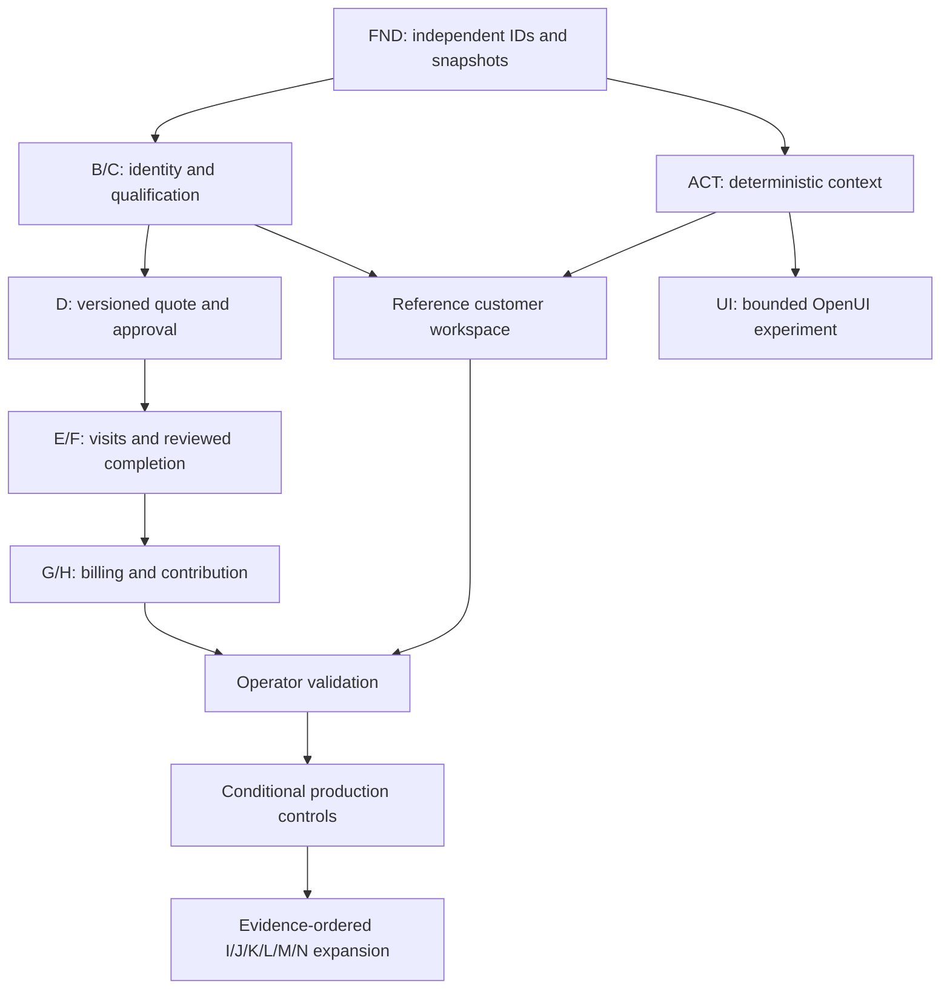

# Feature inventory and dependency map

2026-10-18 · Issue #8. Feature package specifications under prompts/features/; subcapabilities below are explicit inventory, not permission to build them all. Split a subfeature into its own A–Q specification and Issue before independent implementation. No package is user-validated or production-ready.

Evidence states: S specified, D interaction/data contract designed, I implemented, T automated tested. S/D are not pixel-design or usability approval. Legacy means v1 code exists, user rejected overall direction; prior tests apply only to that implementation.

| ID / package (spec filename) | Complete capability inventory | Dependencies | Current evidence / scope |
|---|---|---|---|
| FND-01 DOMAIN_FOUNDATION | Org-scoped IDs, contacts/locations/assets, independent records, historical snapshots, versions/events/idempotency | None | S/D/I/T isolated minimum slice; no UI migration |
| ACT-01 ACTION_CONTEXT | Simultaneous actions, urgency/deadline/impact/dependency/permission/owner, stable ranking and reasons | FND-01 | S/D/I/T initial rules; not wired to v1 |
| A-01 COMMAND_CENTRE | Attention/today, unassigned, waiting quotes, delay risk, overdue invoices, exceptions, workload, decision-linked economics | ACT-01; E/F/G/H/J/M as sources mature | S/D; legacy first-pending list only |
| B-01 CUSTOMER_RELATIONSHIPS | Individuals/orgs, contacts, locations, assets/equipment/history/warranty refs, parallel enquiries/opportunities/jobs/quotes/invoices/payments, interactions/documents/follow-ups | FND-01, ACT-01 | S/D; legacy directory/two Sarah jobs; snapshot command isolated |
| C-01 ENQUIRY_MANAGEMENT | Web/phone/email/manual/referral/return intake, source attribution, matching/duplicate review, classification/eligibility/needs/priority/owner/follow-up/configurable qualification | FND-01, B-01, N-01 minimum service config | S/D; qualification command I/T; legacy creation/email duplicate shape only |
| D-01 QUOTES_ESTIMATES | Services/labor/material estimates, pricing/discount permissions, tax, terms/exclusions, versions/expiry, delivery/approval/follow-up/conversion, accepted snapshots | C-01; N-01 catalog/policy; K-01 for live delivery | S/D; legacy one amount/revision/demo acceptance; version commands next |
| E-01 SCHEDULING_DISPATCH | Variable workdays, availability/skills/territory, customer windows/duration/travel/buffers/resources, assign/reschedule/cancel/return visits/calendars/confirmation | D-01 eligible scope, J-01 resource subset; K-01 delivery later | S/D; legacy AM/PM conflict check; advanced optimization deferred |
| F-01 FIELD_EXECUTION | Instructions/context, prep/checklists/safety, arrival/time/parts/photos/notes, acknowledgment/additional approval, return visits, closeout review | E-01, B-01; I/J subset for costs/resources | S/D; legacy start/notes/three estimates only |
| G-01 BILLING_PAYMENTS | Billability/invoices/tax/terms, deposits/partial payments/refunds/allocations, reconciliation/overdue/receipts/accounting boundary | F-01 review, D-01 accepted terms; K delivery | S/D; legacy before-tax invoice/full payment only |
| H-01 JOB_ECONOMICS | Agreed/invoiced/collected basis, estimated vs actual labor/material/travel/subcontract/other, discounts/adjustments, variance/service/location/customer economics | D/F/G; I/J actual capture later | S/D; legacy direct estimate arithmetic T, no actual profit |
| I-01 INVENTORY_PURCHASING | Product/part catalog, availability/stock locations/reservations, vendors/purchase needs/POs/receipts, consumption, serial/warranty/service links | N catalog, F demand; H cost consumer | S/D; unimplemented; defer warehouse scope |
| J-01 EMPLOYEES_RESOURCES | Profiles, scoped roles, skills/certifications, variable availability, assignments/time/workload/operational performance | N policy, FND IDs | S/D; legacy fixed names only; no payroll/surveillance |
| K-01 COMMUNICATIONS_RETENTION | Enquiry/quote/booking/reminder/change/completion/invoice/receipt/feedback/review/recurring-service messages, consent/recipient/delivery/dedup/follow-up | B identity; relevant event producer | S/D; no sending/queue implementation; simulated first |
| L-01 AUTOMATION_INTEGRATIONS | Triggers/if-else/data/actions/actor/permissions, failure/retry/dedup/audit/success; calendar/accounting/CRM/ERP/form/email/SMS/payment adapters | Tested contracts from producer/consumer; production gate before credentials | S/D; unimplemented; no generic builder now |
| M-01 REPORTING_INTELLIGENCE | Lead/quote conversion, time-to-quote/schedule/completion, first resolution/utilization, invoices/cash/contribution/AR/repeat/source, metric definitions/lineage/period | C–K relevant facts; H finance | S/D; legacy all-record totals only |
| N-01 ADMIN_CONFIGURATION | Org/business locations/territories/catalog/pricing/team/roles/hours/notifications/integrations/industry/workflow/audit | FND; production gate for enforceable auth | S/D; legacy session business/rate only |
| UI-01 OPENUI_ADAPTER | Allowlisted BusinessOS component schema, parse/validate known action context, preserve domain authority, later renderer experiment | ACT-01, reviewed design vocabulary; exact pinned SDK | S/D/I/T parser-only experiment, no renderer/live model/UI claim |

## Dependency graph (implementation gates, not all possible data flows)

N/J minimal configuration and resources are supplied as synthetic fixtures in first slice; full admin/HR is not a hidden prerequisite. K communication events may be simulated before production delivery. I actual stock and J time inputs expand H after validated capture, avoiding a dependency cycle that forces ERP scope.

## Deliberately deferred
Live integrations/automatic messaging, production tenancy/auth/storage/backups, advanced routing/forecasting, predictive AI priorities, general workflow builder, warehouse suite, general ledger, payroll and broad marketing/social/ad management. Add only through evidence, feature/Issue, dependency decision and appropriate tests.
